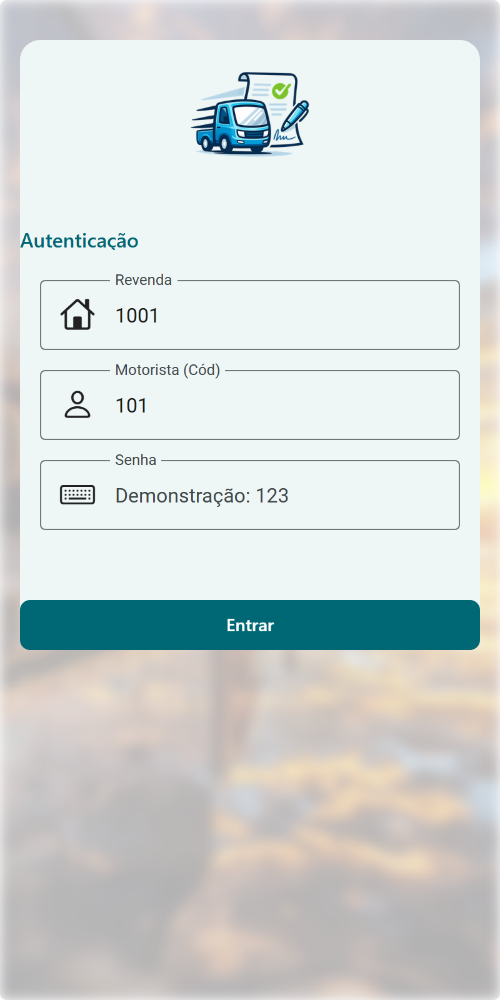
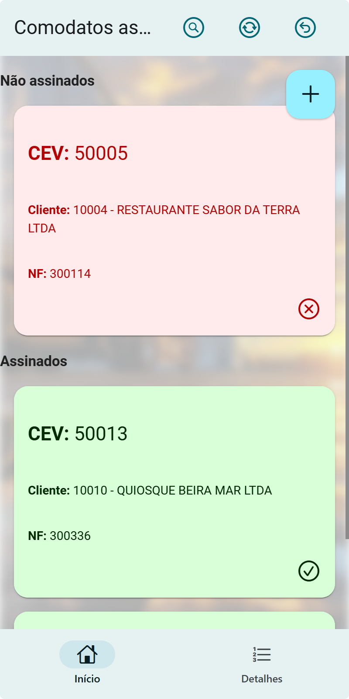
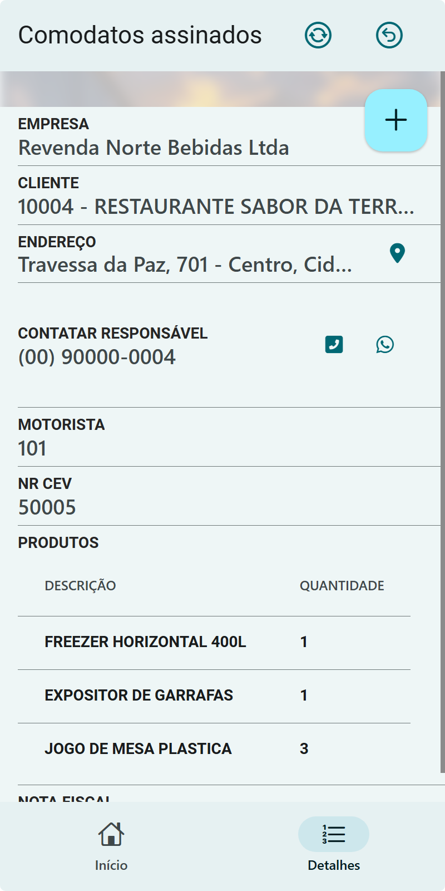
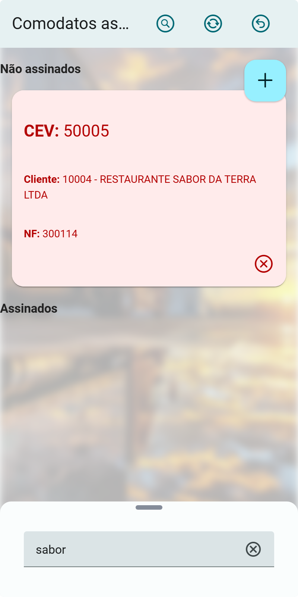

# Comodato Mobile

App mobile em R (**Shiny + shinyMobile**) usado por motoristas de uma distribuidora de bebidas para consultar, **no momento da entrega**, quais comodatos (freezers, visa coolers, mesas, cadeiras, chopeiras etc. emprestados ao cliente) ainda estão **pendentes de assinatura**.

> **Aviso:** esta é uma versão de portfólio. Todos os dados (revendas, clientes, motoristas, telefones, endereços, CNPJs, notas fiscais) são **fictícios**, gerados por `dados/gerar_dados_ficticios.R`. Nenhuma credencial real está no repositório.

> **App descontinuado.** O código fica aqui como registro.

Login de demonstração (ao rodar localmente): **Revenda** `1001` · **Motorista** `101` · **Senha** `123`
(outras revendas: `1002`, `1003`; motorista `9999` vê todos os comodatos da revenda).

## Onde o app entra no processo de comodato

1. A revenda emite o comodato (CEV) e a nota fiscal do equipamento.
2. O motorista leva o equipamento ao cliente e precisa colher a assinatura do contrato.
3. **Na entrega, o motorista abre o app** e vê os CEVs da sua rota separados em *Não assinados* (vermelho) e *Assinados* (verde).
4. Ao tocar em um CEV ele vê os detalhes: empresa, cliente, endereço (com rota no Google Maps), telefone (ligação e WhatsApp), produtos e quantidades, NF e se o documento já foi assinado.

No sistema original o status vem do banco (MariaDB): um CEV é "Assinado" quando há anexo do contrato assinado em `tb_anexos_cev`.

## Telas

| Login | Início | Detalhes | Busca |
|---|---|---|---|
|  |  |  |  |

- **Login**: revenda, código do motorista e senha; a sessão fica salva em cookie (`cookies`).
- **Início**: cards dos CEVs não assinados e assinados do motorista.
- **Detalhes**: dados completos do CEV selecionado.
- **Busca** (ícone de lupa): filtra os cards por cliente, razão social, CEV ou NF.

## Estrutura

```
app/                        # o app (também exportável pelo shinylive)
  app.R                     # UI, login e eventos
  pwa_config.R              # manifest, ícone e service worker (PWA)
  pages/Inicio/
    pag_inicio_app.R        # lista de cards (função home_page)
    pag_detalhes_comod.R    # detalhes do CEV (função pag_detalhes_comod)
    Dados/dados_comodato.R  # leitura dos dados (Parquet)
  dados/comodatos.parquet   # base fictícia
  www/                      # css, imagens, manifest e service worker
dados/gerar_dados_ficticios.R
prints/                     # capturas de tela
```

Cada página é uma função (`home_page()`, `pag_detalhes_comod()`) carregada com `source(..., local = TRUE)` dentro do `server` e exibida via `renderUI`.

## Diferenças em relação ao app em produção

- **Banco de dados → Parquet:** a consulta ao MariaDB (`TB_COMODATO`, `TB_EMPRESAS`, `tb_anexos_cev`, `tb_clientes_inad`) foi trocada pela leitura de `app/dados/comodatos.parquet`, com as **mesmas colunas**, usando `nanoparquet` (funciona no webR; `arrow` e `RMariaDB` não).
- **Usuários:** a tabela de credenciais tem apenas revendas fictícias de demonstração.
- **PWA:** o service worker próprio não é registrado no shinylive (que já usa o seu); localmente ele continua ativo.
- **Caminhos:** o original rodava dentro de um app "roteador" com `addResourcePath("comod_www", ...)`; aqui o app é autônomo e usa a pasta `www/` padrão.
- Login com revenda e motorista pré-preenchidos para facilitar a demonstração.

## Como rodar localmente

```r
install.packages(c("shiny", "shinyMobile", "glue", "dplyr", "shinyjs",
                   "jsonlite", "cookies", "nanoparquet"))

# (opcional) regenerar os dados fictícios, a partir da raiz do repositório
source("dados/gerar_dados_ficticios.R")

shiny::runApp("app")
```

## Rodar no navegador (shinylive)

O app também roda sem servidor, no navegador, pelo shinylive:

```r
shinylive::export("app", "_site")
httpuv::runStaticServer("_site")
```

## Pacotes

shiny, shinyMobile, glue, dplyr, shinyjs, jsonlite, cookies, nanoparquet — todos disponíveis no repositório do webR (repo.r-wasm.org).
